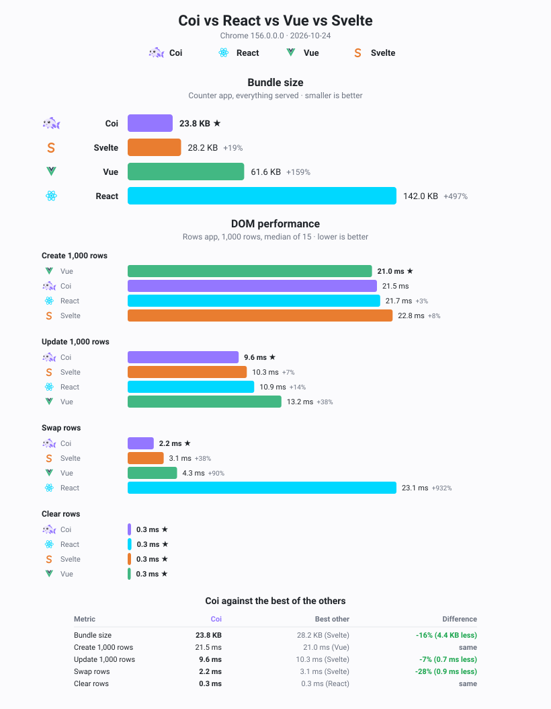

# Framework Benchmark Suite

This suite compares **Coi**, **React**, **Vue**, and **Svelte**.

## What's Measured

| Benchmark | Apps Used | Measures |
|-----------|-----------|----------|
| **Bundle Size** | `apps/counter/*` | Total production build size (HTML + JS + CSS + WASM) |
| **DOM Performance** | `apps/rows/*` | Create, update, swap, and clear 1,000 rows. Each operation is timed from a browser trace: the click's dispatch to the end of the frame's commit, so a 2 ms operation reads 2 ms and not the wait for the next vsync. The frameworks take turns over three cycles of fresh pages (warm-up, then 5 timed runs each), so neither the order nor a slow spell of the machine decides a result; the headline number is the median of the 15 samples |

## Prerequisites

- **Python 3**: For the benchmark runner
- **Node.js & npm**: Required to build React, Vue, and Svelte apps
- **Coi**: The `coi` command must be in PATH
- **Playwright** (optional): For DOM benchmarks (`pip install playwright && playwright install chromium`)

## Run

From the repository root:

```bash
./run.sh framework
```

Or from this suite directory:

```bash
./run.sh
```

### Options

```bash
./run.sh --no-build    # Skip building, use existing dist folders
./run.sh --size-only   # Only measure bundle sizes
./run.sh --dom-only    # Only run DOM performance benchmarks
./run.sh --report-only # Redraw the tables and the chart from the last results, measure nothing
```

## Results

Generated in `results/`:

- `benchmark_results.json` — Raw data: every operation's median, mean, min, max and spread, the browser and the date
- `benchmark_results.svg` — Visual comparison chart


